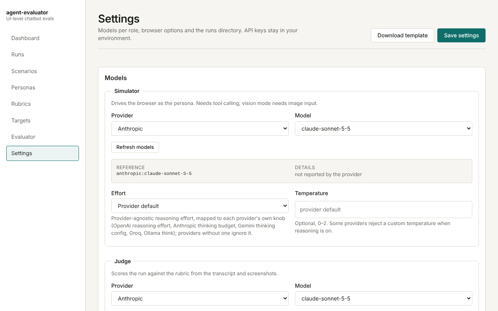
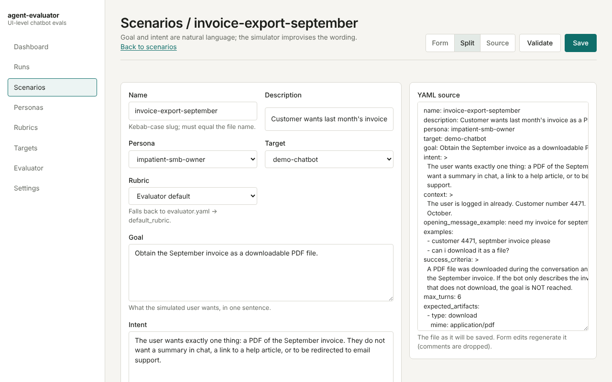
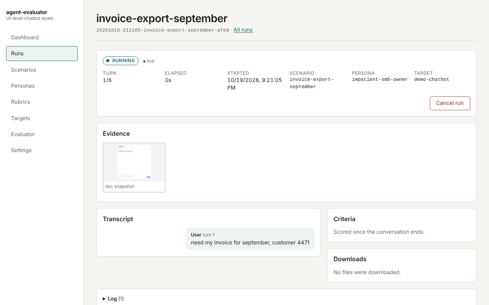
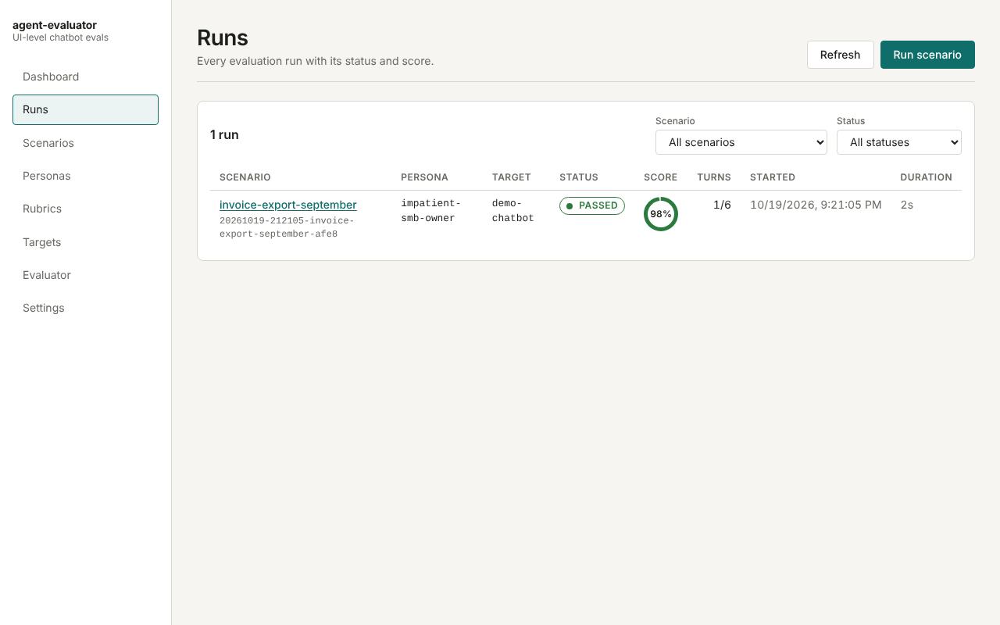
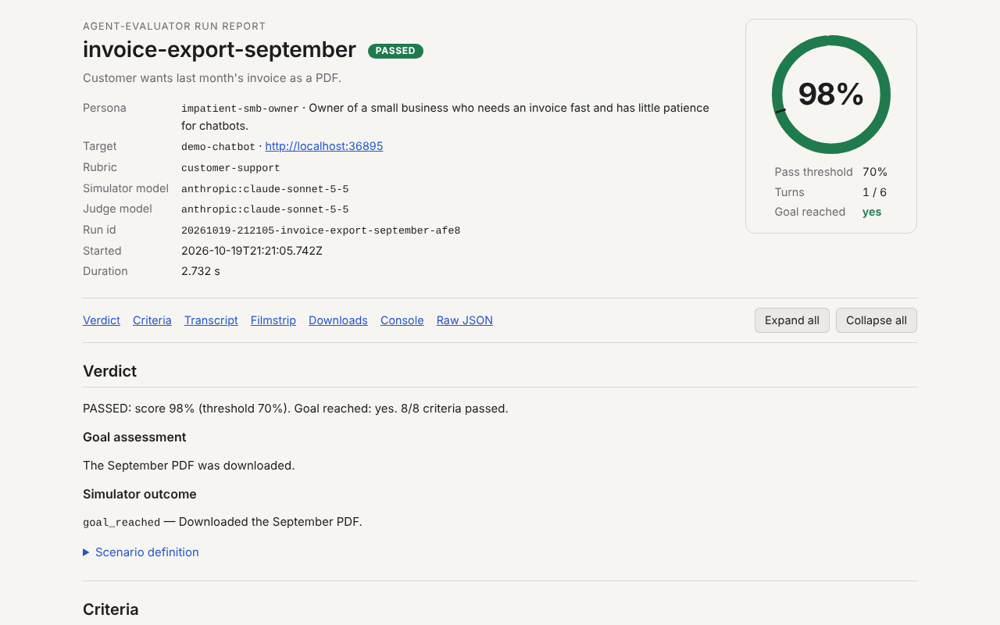
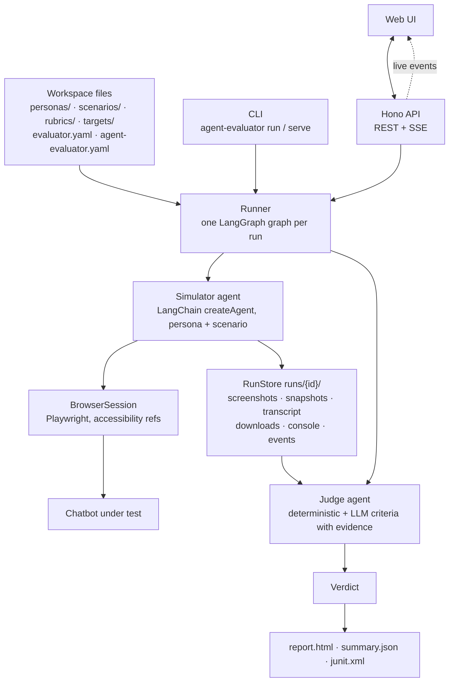
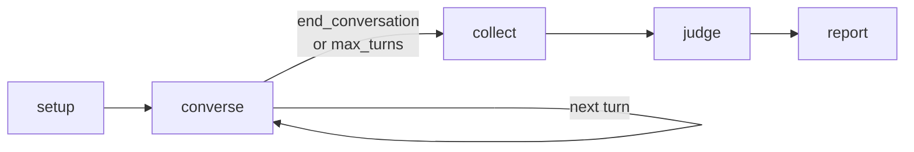

# agent-evaluator v0.1.0

**Automated, UI-level evaluation of chatbots and AI agents: a persona-driven simulated user drives your bot through a real browser, every step is captured as evidence, and an LLM judge scores the conversation against your rubric.**


> **What works today (0.1.0):** the whole pipeline end to end — workspace files, the simulator on
> real Chromium, evidence capture, deterministic and LLM-scored criteria, HTML / JSON / JUnit
> reports, a CLI for CI and a local web UI with editors and a live run view. Verified against the
> built-in demo chatbot; real-world targets with login flows are supported but less travelled.
> See [Known limitations](#known-limitations) and the [Roadmap](#roadmap).

## About

Testing a chatbot through its REST or SSE API tells you what the model said. It does not tell you
whether the download button worked, whether the streamed answer ever finished rendering, or whether a
real, impatient customer would have reached their goal in six messages.

`agent-evaluator` runs the test the way a user would:

1. A **simulator** agent takes on a persona (a Markdown file) and a scenario (a YAML file with a goal,
   an intent and a turn budget), opens the chatbot in Chromium and improvises the conversation. It
   reads the page through the accessibility tree, clicks, types, downloads attachments and takes a
   screenshot after every step.
2. A **judge** agent reads the transcript, the selected screenshots, the extracted content of
   downloaded files and the console log, and scores the run against a rubric of deterministic and
   natural-language criteria, taking your global evaluation principles into account.
3. A **report** (self-contained HTML, JSON, JUnit) shows the percentage score, PASSED/FAILED, every
   criterion with its rationale and the evidence it cites.

A run that exhausts `max_turns` without reaching the goal is FAILED, but the rubric breakdown is still
produced so you can see what worked.

## Screenshots

| Settings: provider → model → effort per role | Scenario editor (form ⇄ YAML source) |
| --- | --- |
|  |  |

| Live run view (evidence strip, transcript, criteria) | Runs list |
| --- | --- |
|  |  |

| HTML report (`report.html`, single file, no external assets) |
| --- |
|  |

All screenshots are taken against the built-in demo chatbot with scripted models; regenerate them with
`npm run build && npx tsx docs/screenshots/capture.ts`.

## Features

- ✅ Persona files in Markdown (`personas/*.md`) with YAML frontmatter, skill-style
- ✅ Scenarios in natural language (`scenarios/*.yaml`): goal, intent, examples, `max_turns`, expected artifacts
- ✅ Rubrics (`rubrics/*.yaml`) mixing LLM criteria with deterministic checks (text, regex, file/MIME, latency, console errors)
- ✅ Global judge principles in `evaluator.yaml`; the built-in `goal_reached` criterion is always scored
- ✅ Hybrid browser perception: accessibility tree with element refs by default, optional vision mode
- ✅ Screenshot after every step plus interim captures while replies stream; downloads saved and parsed (PDF, DOCX, CSV, text)
- ✅ Any LLM provider supported by LangChain; only providers whose key is present in your environment are offered, models are listed live from the provider API, and a provider-agnostic `effort` level maps to each provider's reasoning knob
- ✅ Local server with a visual configuration UI, live run view (SSE) and report viewer
- ✅ CLI for CI pipelines: exit codes, `--json` summaries, JUnit output
- ✅ Built-in demo chatbot with failure modes for trying things out and for the end-to-end tests
- ⏳ Multi-judge voting, run trends, OS keychain secrets (planned, see [Roadmap](#roadmap))

## Requirements

- Node.js ≥ 22.13 (CI runs on 24 and 26)
- Chromium for Playwright: `npx playwright install chromium` (or point `AE_CHROMIUM_PATH` at an existing binary)
- An API key for at least one supported provider (or a local Ollama)

## Installation

### Using npm (default)

```bash
npm install -g agent-evaluator
npx playwright install chromium
```

`npx agent-evaluator <command>` works without a global install.

### From source

```bash
git clone https://github.com/numikel/agent-evaluator.git
cd agent-evaluator
npm ci
npx playwright install chromium
npm run build
```

## Platform setup

The tool is plain Node.js with no native modules; the only platform-specific part is the Chromium
build Playwright drives. CI runs on Ubuntu (Node 24 and 26); macOS and Windows follow the same
steps but have had less testing, so please report anything that behaves differently.

### Windows

1. Install Node.js ≥ 22.13 (24 LTS recommended): `winget install OpenJS.NodeJS.LTS`, or use
   [fnm](https://github.com/Schniz/fnm) / nvm-windows.
2. In PowerShell or Windows Terminal:
   ```powershell
   npm install -g agent-evaluator
   npx playwright install chromium        # goes to %LOCALAPPDATA%\ms-playwright
   ```
   If PowerShell refuses to run `npm`/`npx` ("running scripts is disabled on this system"), either
   call `npm.cmd` / `npx.cmd` or allow signed scripts for your user:
   `Set-ExecutionPolicy -Scope CurrentUser RemoteSigned`.
3. Set keys for the current session with `$env:ANTHROPIC_API_KEY = "sk-..."` (PowerShell) or
   `set ANTHROPIC_API_KEY=sk-...` (cmd). To persist for new terminals use
   `setx ANTHROPIC_API_KEY "sk-..."` or *System Properties → Environment Variables*.
   `dotenvx` and the 1Password CLI work on Windows too.
4. To reuse an installed browser instead of downloading one, point `AE_CHROMIUM_PATH` at Chrome or
   Edge (both are Chromium):
   ```powershell
   $env:AE_CHROMIUM_PATH = "C:\Program Files\Google\Chrome\Application\chrome.exe"
   ```
5. `agent-evaluator serve` binds `127.0.0.1:4747` only; if Windows Firewall asks, no inbound rule
   is needed. Write paths in YAML with forward slashes (`storage_state: ./auth/demo.json`).
   Run the demo chatbot (`agent-evaluator demo`) in a second Windows Terminal tab while `serve` runs.
6. WSL2 works like Linux below. Headed runs (`run --headed`) need WSLg (Windows 11) or an X server.

### macOS

1. Install Node.js ≥ 22.13: `brew install node@24` (or fnm / nvm). Apple Silicon and Intel both
   get a native Chromium build from Playwright.
2. ```bash
   npm install -g agent-evaluator
   npx playwright install chromium        # goes to ~/Library/Caches/ms-playwright
   ```
3. Set keys in the shell (`export ANTHROPIC_API_KEY=sk-...`; add to `~/.zshrc` to persist), or use
   `dotenvx` / `op run` (`brew install 1password-cli`) so nothing lands in plain text.
4. To reuse the installed Chrome:
   ```bash
   export AE_CHROMIUM_PATH="/Applications/Google Chrome.app/Contents/MacOS/Google Chrome"
   ```
5. The first headed run may trigger a macOS prompt to allow Chromium to accept incoming
   connections; it can be declined, the tool only talks to the browser locally.

### Linux

1. Install Node.js ≥ 22.13 from your distribution, [NodeSource](https://github.com/nodesource/distributions) or fnm.
2. Chromium needs a few system libraries (libnss3, libatk, libgbm, …). The simplest way is to let
   Playwright install them:
   ```bash
   npm install -g agent-evaluator
   npx playwright install --with-deps chromium   # uses sudo/apt on Debian/Ubuntu
   ```
   On other distributions install the distro's `chromium` package and point the tool at it:
   `export AE_CHROMIUM_PATH=/usr/bin/chromium` (or `/usr/bin/google-chrome`).
3. Headless is the default, so no display is required. For `--headed` on a server use
   `xvfb-run agent-evaluator run …`.
4. Set keys with `export`, a git-ignored `.env`, or `direnv` + `sops`.
5. In Docker or CI, the `mcr.microsoft.com/playwright:v1.64.1-noble` image already contains a
   matching Chromium; otherwise run `npx playwright install --with-deps chromium` in the pipeline
   (see [CI usage](#ci-usage)).

### Environment variables by shell

| Action | bash / zsh | PowerShell | cmd |
| --- | --- | --- | --- |
| Set for this session | `export X=value` | `$env:X = "value"` | `set X=value` |
| Set for one command | `X=value agent-evaluator run …` | `$env:X="value"; agent-evaluator run …` | `set X=value && agent-evaluator run …` |
| Persist for new shells | add `export` to `~/.bashrc` / `~/.zshrc` | `setx X "value"` | `setx X "value"` |
| Unset | `unset X` | `Remove-Item Env:X` | `set X=` |

Playwright's browser cache can be relocated on every OS with `PLAYWRIGHT_BROWSERS_PATH`;
`AE_CHROMIUM_PATH` always wins when set. `agent-evaluator doctor` prints which binary and which
keys were found.

## Quick start

```bash
mkdir my-bot-evals && cd my-bot-evals
agent-evaluator init          # creates personas/, scenarios/, rubrics/, targets/, evaluator.yaml, agent-evaluator.yaml
export ANTHROPIC_API_KEY=...  # or any other provider key; or use a vault, see "Secrets"
agent-evaluator doctor        # keys, Chromium, workspace files, configured models
agent-evaluator serve --open  # web UI on http://127.0.0.1:4747
```

Try it against the built-in demo chatbot first. Open a second terminal and start it (port 3999; the
`demo-chatbot` target created by `init` already points there):

```bash
agent-evaluator demo
```

Then, from your workspace:

```bash
agent-evaluator run invoice-export-september
```

The run streams its progress to stderr, prints a summary table to stdout and leaves
`runs/<run-id>/report.html` behind. Exit code 1 means a run FAILED or ERRORed.

## How it works



Every run goes through five steps:



1. **setup** — resolve the scenario with its persona, target, rubric (built-in criteria applied),
   evaluator config and settings; write `scenario.snapshot.yaml`; open the target URL in a fresh
   browser context; when `auth.login_steps` is set, run a one-turn login pass recorded as turn 0.
2. **converse** — the simulator agent drives the page with browser tools (`snapshot`, `click`,
   `type`, `send_message`, `download`, `upload`, … plus `screenshot_view`/`click_at`/`type_at` in
   vision mode). Every tool call becomes a step with before/after screenshots, the accessibility
   snapshot and `action.json`; `send_message` waits for the reply to stabilise and takes interim
   screenshots while it streams. The agent stops by calling `end_conversation` (`goal_reached`,
   `gave_up`, `blocked`), when `max_turns` is exhausted, or when its tool-call budget
   (8 per turn) runs out.
3. **collect** — drain console messages and failed requests, close the browser.
4. **judge** — extract downloaded files to text, compute deterministic criteria, pick up to
   `max_images` screenshots (uniformly or with a selector model), score each LLM criterion with
   structured output, aggregate into `verdict.json`. A run that exhausted `max_turns` cannot pass.
5. **report** — render `report.html` (screenshots inlined), `summary.json` and `junit.xml`;
   the run record becomes `PASSED` or `FAILED`.

Every event (`run_started`, `turn`, `step`, `message`, `download`, `criterion`, `done`, …) is
appended to `events.jsonl` before it is streamed, so the UI can reload mid-run and replay history.
See [`docs/architecture.md`](./docs/architecture.md) for the module map and evidence layout.

## CLI reference

```
agent-evaluator <command> [options]
```

| Command | Arguments / options | What it does |
| --- | --- | --- |
| `init [dir]` | `-f, --force` overwrite existing files with the shipped templates | Creates the workspace layout with an example persona, scenario, rubric, target, `evaluator.yaml` and `agent-evaluator.yaml`. Prints the files it created; a second run without `--force` changes nothing. |
| `serve` | `-p, --port <port>` (default: settings, 4747; `0` picks a free port) · `-H, --host <host>` (default: settings, 127.0.0.1) · `-w, --workspace <dir>` · `--open` open the UI in your browser | Starts the web UI and the HTTP API. Ctrl+C stops the server and cancels in-flight runs. |
| `run <scenario...>` | `-t, --target <name>` override the scenario's target · `-r, --repeat <n>` run each scenario *n* times (multiplied by `scenario.repeat`) · `--headed` show the browser window · `--json` print the `summary.json` objects as a JSON array instead of the table · `--fail-on-error` cancel the runs still pending once a run ends in ERROR · `-w, --workspace <dir>` | Resolves every scenario first (a typo starts nothing), runs them through the runner, streams progress to stderr (turn k/N, steps, messages, downloads, per-criterion ✓/✗, verdict) and prints a summary table (scenario, status, score, turns, report path) to stdout. |
| `validate` | `-w, --workspace <dir>` | Validates every workspace file against its schema, checks that `name:` matches the file name and that each scenario's persona, target and rubric exist. Lists issues as `<path>: <field>: <message>`. |
| `report <runId>` | `--open` open the rendered report · `-w, --workspace <dir>` | Re-renders `report.html`, `summary.json` and `junit.xml` of a finished run from its stored artifacts, using `scenario.snapshot.yaml` (falls back to the current workspace files). |
| `templates` | `-o, --out <dir>` write all template files into a directory · `-k, --kind <kind>` only this kind (`persona`, `scenario`, `rubric`, `target`, `evaluator`, `settings`); printed to stdout when `--out` is absent | Exports the shipped templates. Without options it lists them. |
| `demo` | `-p, --port <port>` (default: 3999) · `-m, --mode <mode>` default behaviour: `normal`, `slow`, `offtopic`, `broken`, `noattach` (a page can override it with `?mode=`) | Starts the built-in demo chatbot that the template target points at, so the quick start works without cloning the repository. Ctrl+C stops it. |
| `doctor` | `-w, --workspace <dir>` | Prints one ✓/✗ line per check with a fix hint: each provider's key, Chromium for Playwright, workspace files, whether the models configured for `simulator` and `judge` point at a configured provider, and whether each target URL answers (informational). |

Global options: `-V, --version`, `-h, --help` (also per command).

**Exit codes:** `0` on success. `1` when any run is `FAILED` or `ERROR` (`run`), when `validate`
finds issues, when `doctor` finds a blocking problem (a configured model role without a key, or
Chromium missing), on usage errors and on unexpected errors (message on stderr). Unconfigured
providers that no role uses are reported by `doctor` but are not blocking.

**Environment variables** read by the CLI and the server:

| Variable | Effect |
| --- | --- |
| `ANTHROPIC_API_KEY`, `OPENAI_API_KEY`, … | Provider keys, see [Secrets](#secrets) |
| `AE_PORT`, `AE_RUNS_DIR`, `AE_HEADLESS`, `AE_MODEL_SIMULATOR`, `AE_MODEL_JUDGE` | Override the corresponding settings (`server.port`, `runs_dir`, `browser.headless`, `models.*`); precedence is file < environment < CLI flags |
| `AE_CHROMIUM_PATH` | Chromium binary to use instead of Playwright's bundled build |
| `LOG_LEVEL` | pino log level of the server (`info` by default, `warn` for the CLI) |
| `NO_COLOR` / `FORCE_COLOR` | Disable / force ANSI colours in CLI output |
| `AE_LIVE_LLM=1` | Enables the opt-in live-LLM smoke test (`npm run test:live`); never set in CI |
| `AE_E2E_WORKSPACE_DIR`, `AE_E2E_KEEP=1` | Where the end-to-end tests create their workspaces, and whether to keep them |

## Configuration

All configuration is plain files in your workspace directory. Templates are shipped in
[`templates/`](./templates), can be exported with `agent-evaluator templates` and downloaded from the
UI. Names are kebab-case slugs and must match the file name. Validation runs on every load, in the
UI editors (on blur and before save) and through `agent-evaluator validate`.

| File | Purpose |
| --- | --- |
| `personas/<name>.md` | Who the simulated user is: background, goals, communication style, knowledge, constraints |
| `scenarios/<name>.yaml` | What they want: `goal`, `intent`, `success_criteria`, `max_turns`, `expected_artifacts` |
| `rubrics/<name>.yaml` | What the judge scores: weighted criteria, `required` flags, `pass_threshold` |
| `targets/<name>.yaml` | The chatbot under test: `url`, optional auth, natural-language hints, timeouts |
| `evaluator.yaml` | Global judge principles, screenshot budget, evidence selection, default rubric |
| `agent-evaluator.yaml` | Models per role (`simulator`, `judge`, `evidence_selector`), effort, temperature, browser and server settings |

### Persona (`personas/<name>.md`)

YAML frontmatter between `---` lines, then a free-form Markdown body (background, goals,
communication style, knowledge, constraints). The whole file is given to the simulator.

| Field | Type | Default | Meaning |
| --- | --- | --- | --- |
| `name` | slug | required | Must equal the file name |
| `description` | string (1–1024) | required | One-line summary shown in lists and reports |
| `language` | string | `en` | Language the persona writes in (BCP-47-ish tag) |
| `traits` | string[] | `[]` | Short adjectives, e.g. `impatient`, `non-technical` |
| `interaction_style` | string[] | `[]` | Behavioural modifiers, e.g. `short-messages`, `occasional-typos` |
| `version` | positive integer | `1` | Your own versioning of the persona |

### Scenario (`scenarios/<name>.yaml`)

| Field | Type | Default | Meaning |
| --- | --- | --- | --- |
| `name` | slug | required | Must equal the file name |
| `description` | string | — | Shown in lists and in the report header |
| `persona` | slug | required | Persona file to use |
| `target` | slug | required | Target file to use (overridable per run) |
| `rubric` | slug | `evaluator.yaml#default_rubric` | Rubric file to score with |
| `goal` | string | required | What the user wants, in natural language |
| `intent` | string | required | Why, and what would not count |
| `context` | string | — | Preconditions and facts the simulated user knows (customer number, dates) |
| `opening_message_example` | string | — | Inspiration for the first message, never a script |
| `examples` | string[] | `[]` | More examples of the user's phrasing |
| `success_criteria` | string | required | When the simulated user should consider the goal reached |
| `max_turns` | integer 1–100 | required | User → bot exchanges allowed; exceeding it fails the run |
| `expected_artifacts` | list of `{ type: download \| image \| link, mime?, description? }` | `[]` | Artifacts the user expects (hints for simulator and judge) |
| `repeat` | integer 1–50 | `1` | Run the scenario N times to observe non-determinism |
| `vision` | boolean | `false` | Add screenshot-based (x/y) tools to the accessibility refs |
| `tags` | string[] | `[]` | Free labels |

### Rubric (`rubrics/<name>.yaml`)

| Field | Type | Default | Meaning |
| --- | --- | --- | --- |
| `name` | slug | required | Must equal the file name |
| `description` | string | — | |
| `pass_threshold` | number 0–1 | `0.7` | Weighted score required to pass |
| `criteria` | list (≥ 1) | required | Criteria, unique `id`s |

Every criterion has `id` (slug or snake_case), `description` (required), `weight` (positive number,
default `1`) and `required` (boolean, default `false`; a failing required criterion fails the run).
The `type` selects the extra fields:

| `type` | Extra fields | Meaning |
| --- | --- | --- |
| `llm` | `scale`: `binary` \| `0-1` \| `0-5` (default `0-5`) · `levels`: map of level → description | Scored by the judge model from the transcript, screenshots and files; the score is normalised to 0–1 |
| `contains` | `text` (required) · `in`: `bot` \| `user` \| `files` \| `any` (default `bot`) · `case_sensitive` (default `false`) | Text must appear in the chosen scope |
| `regex` | `pattern` (required) · `flags` (subset of `gimsuy`, default empty) · `in` (default `bot`) | Pattern must match in the chosen scope |
| `file` | `mime` (exact or `type/*`) · `min_bytes` · `contains` (text in the extracted content) | At least one downloaded file satisfies every given constraint |
| `max_response_time_ms` | `value` (ms, required) · `aggregate`: `max` \| `p95` \| `p50` (default `max`) | Bot reply latency (first stable render) over all turns |
| `no_console_errors` | `ignore`: regex patterns (default `[]`) | No `console.error` in the page during the session, except ignored ones |

The built-in `goal_reached` criterion (`llm`, binary, weight 3, required) is prepended to every
rubric unless you define a criterion with that id yourself.

### Target (`targets/<name>.yaml`)

| Field | Type | Default | Meaning |
| --- | --- | --- | --- |
| `name` | slug | required | Must equal the file name |
| `description` | string | — | |
| `url` | http(s) URL | required | Page that shows (or leads to) the chat |
| `auth.storage_state` | path | — | Playwright `storageState` JSON (cookies + localStorage) captured beforehand, relative to the workspace |
| `auth.login_steps` | string | — | Natural-language login instructions the simulator follows as turn 0 |
| `auth.credentials_env.username` / `.password` | env var names | — | Variables holding the credentials; values are read from the environment at run time and never stored in the workspace |
| `hints` | string[] | `[]` | Natural-language hints for tricky UIs ("the chat opens after clicking the bubble bottom-right") |
| `timeouts.response_ms` | integer ms | `60000` | Max wait for a bot reply to start and settle |
| `timeouts.stable_ms` | integer ms | `1500` | Reply is complete when the page is unchanged (and no request younger than this is in flight) for this long |
| `timeouts.navigation_ms` | integer ms | `30000` | Page navigation timeout; also how long the simulator waits for a disabled chat input to become editable |
| `timeouts.capture_interval_ms` | integer ms | `2000` | Interim screenshot cadence while waiting for a reply |
| `viewport` | `{ width, height }` | `1280 × 800` | Browser viewport |
| `vision` | boolean | `false` | Vision mode for this target (OR-ed with the scenario's flag) |
| `headless` | boolean | `true` | Headless browser; `run --headed` or the UI's "headed" toggle override it per run |

### Evaluator (`evaluator.yaml`)

| Field | Type | Default | Meaning |
| --- | --- | --- | --- |
| `principles` | string | required | Global rules the judge applies to every run, in natural language |
| `max_images` | integer 0–50 | `10` | Screenshots passed to the judge model per run |
| `default_rubric` | slug | — | Rubric used when a scenario names none |
| `evidence_selection` | `llm` \| `uniform` | `llm` | `llm`: a selector model picks the key steps (falls back to `uniform` on any failure); `uniform`: evenly spaced steps, first and last always kept |
| `judge_instructions` | string | — | Extra instructions appended to every judge prompt |

### Settings (`agent-evaluator.yaml`)

| Field | Type | Default | Meaning |
| --- | --- | --- | --- |
| `models.simulator` | `provider:model` | see template | Model that drives the browser as the persona (needs tool calling; vision mode needs image input) |
| `models.judge` | `provider:model` | see template | Model that scores the run (image input recommended) |
| `models.evidence_selector` | `provider:model` | the judge model | Model that picks key screenshots when `evidence_selection: llm`; inherits the judge's effort and temperature when omitted |
| `temperature.<role>` | number 0–2 | — | Sent to the provider only when set |
| `effort.<role>` | `none` \| `low` \| `medium` \| `high` \| `max` | — | Reasoning effort, mapped per provider (see [Model selection](#model-selection)) |
| `browser.headless` | boolean | `true` | Default for every target |
| `browser.slow_mo_ms` | integer ms | `0` | Playwright `slowMo`, useful with `--headed` |
| `concurrency` | integer 1–16 | `1` | Scenarios executed in parallel browser contexts |
| `runs_dir` | path | `runs` | Where run artifacts are written (relative to the workspace) |
| `server.port` | integer | `4747` | |
| `server.host` | string | `127.0.0.1` | Bind address of `serve` |

Model references must be explicit `provider:model` strings; bare model names are rejected.
Supported provider ids: `anthropic`, `openai`, `google-genai`, `openrouter`, `xai`, `mistralai`,
`groq`, `ollama`.

### Secrets

API keys are read from environment variables only and are never written to disk by the tool.

| Variable | Provider |
| --- | --- |
| `ANTHROPIC_API_KEY` | `anthropic:` |
| `OPENAI_API_KEY` | `openai:` |
| `GOOGLE_API_KEY` | `google-genai:` |
| `OPENROUTER_API_KEY` | `openrouter:` |
| `XAI_API_KEY` | `xai:` |
| `MISTRAL_API_KEY` | `mistralai:` |
| `GROQ_API_KEY` | `groq:` |
| `OLLAMA_BASE_URL` | `ollama:` (local, no key; e.g. `http://localhost:11434`) |

Avoid plaintext key files. Recommended ways to inject keys:

- **dotenvx**: `dotenvx run -- agent-evaluator serve` with an encrypted `.env` (private key stays outside the repo)
- **1Password CLI**: `op run --env-file=.env.tpl -- agent-evaluator serve` where `.env.tpl` holds `op://` references
- **direnv + sops**: decrypt on `cd`, never on disk in clear text
- **CI secrets**: GitHub Actions `secrets.*` mapped to the variables above

A plain `.env` in the workspace works for local experiments (it is loaded at start-up and git-ignored);
`.env.example` lists variable names only. The HTTP API and the UI only ever report whether a provider
is configured, never the value ([ADR-0002](./docs/decisions/ADR-0002-secrets.md)).

## Model selection

- **Configured providers only.** The settings page and `GET /api/providers` list the providers whose
  environment variable is set; nothing else is offered. `agent-evaluator doctor` shows the full list
  with the missing variable for each.
- **Live model lists.** Models are fetched from each provider's listing API (10-minute cache,
  "Refresh models" in the UI). When the call fails or the provider has no listing endpoint, a
  short fallback list is shown with a "fallback list" notice; you can still type any model id in
  the YAML.
- **Per role.** `simulator`, `judge` and optionally `evidence_selector` each get a provider → model →
  effort cascade. The model card shows the context window, max output tokens and image/reasoning
  support when the provider reports them.
- **Output tokens** default to the model's own maximum (from LangChain's model profile) so answers
  are never truncated below what the model allows; conversation context is never trimmed.
- **Effort** is one provider-agnostic knob, mapped to each provider's own parameter:

| Provider | `none` | `low` | `medium` | `high` | `max` | Parameter |
| --- | --- | --- | --- | --- | --- | --- |
| openai, xai | omitted | `low` | `medium` | `high` | `high` | `reasoning: { effort }` |
| anthropic | omitted | 2048 | 8192 | 16384 | 32000 | `thinking: { type: "enabled", budget_tokens }` |
| google-genai | 0 | 2048 | 8192 | 16384 | 24576 | `thinkingConfig: { thinkingBudget }` |
| groq | `none` | `low` | `medium` | `high` | `high` | `reasoningEffort` |
| ollama | `false` | `true` | `true` | `true` | `true` | `think` |
| openrouter | omitted | `low` | `medium` | `high` | `high` | `modelKwargs: { reasoning: { effort } }` |
| mistralai | ignored | ignored | ignored | ignored | ignored | — |

An unset `effort` leaves the provider default. Models that do not support reasoning ignore the
parameter or reject it, depending on the provider (see [Known limitations](#known-limitations)).

## Scoring

Every criterion yields a normalised score in 0–1 (`binary` → 0 or 1, `0-5` → divided by 5,
deterministic checks → 0 or 1) and a `pass` flag. The run score is the weighted mean:

```
score = Σ (weight × score) / Σ weight
```

A run is **PASSED** only when all of the following hold:

1. the judge considers the goal reached (`goal_reached`, binary, weight 3, required by default);
2. no `required` criterion failed;
3. `score ≥ pass_threshold` (rubric, default `0.7`).

Otherwise it is **FAILED**, with the full criteria breakdown still reported. A conversation that
exhausted `max_turns` before the simulated user ended it is always FAILED: `goal_reached` is
forced to fail and the score recomputed, whatever the judge concluded. The judge's own assessment of
the goal overrides the simulator's `end_conversation` claim in every other case. A run that could not
be completed (browser or model error, cancellation) is **ERROR** and has no verdict.

## Reports

Each run writes to `runs/<run-id>/` (see [`docs/architecture.md`](./docs/architecture.md) for the
full evidence layout):

- **`report.html`** — a single self-contained file (inline CSS, inlined screenshots, light/dark,
  no external assets): status badge and percentage gauge, pass threshold, turns used, the criteria
  table with reasons and evidence links, the transcript with the screenshot of each turn, a filmstrip
  of every step including interim captures, downloads with extracted text excerpts, console errors,
  the judge's summary and goal assessment, and the raw JSON in a collapsible.
- **`summary.json`** — `{ runId, scenario, status, score, percent, pass_threshold, goal_reached,
  turns_used, max_turns, criteria: [{ id, score, pass, required }], started_at, finished_at }`.
  `agent-evaluator run --json` prints these objects (runs that ended in `ERROR` get a synthesized
  entry with an `error` field).
- **`junit.xml`** — one `<testcase>` per criterion with a `<failure>` on fail; a FAILED run without
  failing criteria or an ERROR run adds a `run` testcase. Point your CI's JUnit reporter at
  `runs/**/junit.xml`.
- **`verdict.json`** — the judge's output; `run.json` — the run record; `events.jsonl`,
  `transcript.jsonl`, `console.jsonl`, `steps/NNN/`, `downloads/` — the evidence.

### CI usage

```yaml
- run: npx playwright install --with-deps chromium
- run: npx agent-evaluator doctor
  env: { ANTHROPIC_API_KEY: "${{ secrets.ANTHROPIC_API_KEY }}" }
- run: npx agent-evaluator run invoice-export-september checkout-help --json > summary.json
  env: { ANTHROPIC_API_KEY: "${{ secrets.ANTHROPIC_API_KEY }}" }
- uses: actions/upload-artifact@v4
  if: always()
  with: { name: agent-evaluator-runs, path: runs/**/report.html }
```

The `run` command exits `1` when any run is FAILED or ERROR, so the job fails with the reports attached.

### HTTP API

`serve` exposes the same operations the UI uses, under `/api`: `GET /health`, `GET /workspace`,
`GET|PUT|DELETE /{personas,scenarios,rubrics,targets}/:name`, `GET|PUT /evaluator`,
`GET|PUT /settings`, `POST /validate`, `GET /templates/:kind`, `GET /providers`,
`GET /providers/:id/models`, `GET|POST /runs`, `GET /runs/:id`, `POST /runs/:id/cancel`,
`GET /runs/:id/events` (SSE, replays history), `GET /runs/:id/artifacts/*` and
`GET /runs/:id/report`. Request and response shapes live in `src/schemas/api.ts`.

## Known limitations

- **Streamed replies that stall.** A reply is considered complete when the chat region stops
  changing and no request younger than `stable_ms` is in flight. A backend that stalls mid-stream
  (or keeps an SSE connection open forever) is therefore reported as a finished, truncated reply to
  the simulator; only the judge sees the resulting console error (`no_console_errors`) and the
  missing content. Use a `max_response_time_ms` or `no_console_errors` criterion to catch it.
- **Effort is a no-op on some models.** xAI's `grok-*` models ignore the reasoning effort
  parameter; Mistral has no knob at all.
- **Anthropic rejects `temperature ≠ 1` with extended thinking.** Set `effort` *or* a custom
  temperature for Anthropic roles, not both; the tool does not enforce this.
- **Login credentials can end up in the evidence.** When `auth.credentials_env` is used, the login
  pass types the values into the page: they can appear in turn-0 screenshots and in
  `steps/NNN/action.json`. Prefer `auth.storage_state` captured outside the tool, and treat `runs/`
  as sensitive.
- **Single judge.** Each criterion is scored once by one model; multi-judge voting is planned.
- **Vision mode is lightly tested.** The x/y tools and annotated screenshots work, but the demo
  chatbot exercises only the accessibility-ref path.
- **Filesystem only.** There is no run index; the runs list reads every `run.json` on each request.

## Troubleshooting

| Symptom | Fix |
| --- | --- |
| `Chromium not found. Run npx playwright install chromium or set AE_CHROMIUM_PATH …` | Run `npx playwright install chromium` (in CI: `npx playwright install --with-deps chromium`), or point `AE_CHROMIUM_PATH` at an existing Chromium/Chrome binary. `agent-evaluator doctor` shows which path is checked. |
| `Target "demo-chatbot" is not reachable at http://localhost:3999 (ERR_CONNECTION_REFUSED)` | Nothing is listening at the target URL. For the built-in demo start `agent-evaluator demo` in another terminal; for your own bot check the `url` in `targets/<name>.yaml`. `agent-evaluator doctor` probes every target. |
| `provider 'x' is not configured (set X_API_KEY)` / the settings page says no provider is configured | Export the variable for the provider named in `agent-evaluator.yaml` (`doctor` prints the exact `export` line), or inject it with dotenvx / `op run` / sops. The UI only offers providers whose key is present. |
| Model list shows "fallback list" | The provider's listing endpoint failed (network, key, quota). The run still works with any model id you type; click "Refresh models" after fixing the cause. |
| `send_message` returns `(no reply detected …)` or the bot's reply is cut off | Raise `timeouts.response_ms` / `stable_ms` in the target for slow backends; lower `stable_ms` for snappy ones. Check the interim screenshots in the filmstrip to see what the page did. |
| The run ends `blocked` | The simulator ran out of tool calls (8 per turn) without making progress, typically because it could not find the chat input. Add `hints` to the target (where the chat opens, how messages are sent) or enable `vision` for canvas-heavy UIs. |
| Run stays `ERROR: cancelled` | The server was stopped or `cancel` was clicked; rerun the scenario. |
| The simulated user types too early / the message is dropped | The browser waits (up to `timeouts.navigation_ms`) for a disabled chat input to become editable; UIs that silently drop input while busy need a target hint such as "wait for the typing indicator to disappear". |
| Linux: `error while loading shared libraries: libnss3.so` (or similar) when the browser starts | Chromium's system libraries are missing: `npx playwright install --with-deps chromium`, or install your distribution's `chromium` package and set `AE_CHROMIUM_PATH`. |
| Windows: `npm.ps1 cannot be loaded because running scripts is disabled` | Use `npm.cmd` / `npx.cmd`, or `Set-ExecutionPolicy -Scope CurrentUser RemoteSigned` once. |
| Windows/WSL: `--headed` shows nothing | Headed mode needs a display: WSLg on Windows 11, or run headless (the default) and inspect the screenshots in the report. |
## Roadmap

Multi-judge voting · SQLite run index and trend dashboard · LangSmith tracing · OS keychain
`SecretsProvider` · scenario generator from an agent description · interaction-style perturbations
(typos, language switch) · Anthropic native computer-use toolset mode · `agent-browser` as an
alternative `BrowserSession` · real-UI targets with login flows.

## Project structure

```
src/
  schemas/      zod schemas shared by server, agents and UI (+ computeOutcome)
  workspace/    workspace files and run artifact store
  config/       settings, secrets provider, provider registry, model factory, effort mapping, doctor
  browser/      Playwright session (accessibility refs, screenshots, downloads, reply stability)
  agents/       simulator and judge agents (LangChain createAgent)
  runner/       LangGraph orchestration, run events, step recorder
  report/       HTML / JSON / JUnit report rendering
  server/       Hono REST + SSE API, serves the UI
  cli/          agent-evaluator CLI (commander)
  testing/      ScriptedChatModel and FakeBrowserSession test doubles
ui/             Vite + React configuration and run UI
fixtures/       demo chatbot used by the end-to-end tests and the quick start
templates/      workspace file templates (also shipped in the npm package)
e2e/            end-to-end suite (real Chromium, demo chatbot, scripted models)
docs/           architecture, decisions (ADRs), phase plans, screenshots
```

## Development

### Setup

```bash
npm ci
npx playwright install chromium   # or export AE_CHROMIUM_PATH=/path/to/chromium
```

### Running tests

```bash
npm test               # unit + ui (Vitest projects)
npm run test:coverage
npm run test:e2e       # full pipeline against the demo chatbot (~20 s, needs Chromium)
npm run test:live      # opt-in smoke test with real models (AE_LIVE_LLM=1, your keys)
```

`test:live` sets `AE_LIVE_LLM=1` with POSIX syntax; on Windows run
`$env:AE_LIVE_LLM = "1"; npm run test:e2e` in PowerShell instead.

### Code quality and validation

```bash
npm run verify         # lint + typecheck + build + unit/ui tests (the definition of done)
npm run fix            # Biome autofix
npm run demo           # demo chatbot on http://localhost:3999 (DEMO_PORT to change)
```

Development follows TDD (red → green → refactor) with one Conventional Commit per phase. Read
[`docs/plans/README.md`](./docs/plans/README.md) and [`CLAUDE.md`](./CLAUDE.md) before contributing.

### Releasing

1. Move the `changelog.d/` fragments into a new `CHANGELOG.md` section and bump `version` in
   `package.json` (`chore(release): x.y.z`), merged to `main` through a pull request.
2. `npm run verify && npm run test:e2e && npm pack --dry-run` — the tarball must contain only
   `dist/`, `templates/` (without tests), `README.md`, `LICENSE`, `NOTICE` and `package.json`.
3. Start the `release.yml` workflow in one of two ways:
   - push the tag: `git tag vx.y.z && git push origin vx.y.z`, or
   - Actions → Release → **Run workflow** on `main` with the version as input (works from the GitHub
     mobile app); the job creates the `vx.y.z` tag itself.
   The job checks that the version matches `package.json`, builds, and runs
   `npm publish --provenance --access public`.
4. Credentials: the repository secret `NPM_TOKEN` must hold an npm granular access token with
   *Read and write (publish and stage)* permission and *Bypass two-factor authentication* enabled.
   With such a token npm **stages** the publish: the job ends green, but the version goes live only
   after a maintainer approves it on npmjs.com (package → *Staged Packages* → Approve, with a 2FA
   code) or with `npm stage approve <stage-id>` (npm ≥ 11.15). Without the secret the job fails at
   `npm publish` and nothing is published.
5. Recommended once the package exists: configure
   [Trusted Publishing](https://docs.npmjs.com/trusted-publishers/) on npmjs.com for this repository
   and workflow (`numikel/agent-evaluator`, `release.yml`). Then the `NODE_AUTH_TOKEN` line can be
   removed from the workflow, the secret deleted, and releases publish directly without the staging
   step. The first OIDC publish must happen within two days of configuring it.

## Changelog

See [`CHANGELOG.md`](./CHANGELOG.md).

## Contributing

1. Create a feature branch (`git checkout -b feat/my-change`).
2. Add or update tests for behaviour changes.
3. Run `npm run verify`.
4. Use Conventional Commits (`feat(judge): add latency criterion`).
5. Add a changelog fragment under `changelog.d/`.

Details, including the test-first workflow and the release procedure, are in
[`CONTRIBUTING.md`](./CONTRIBUTING.md). This project follows the
[code of conduct](./CODE_OF_CONDUCT.md). Security issues go through the
[security policy](./SECURITY.md).

## License

Licensed under the [Apache License 2.0](./LICENSE). Copyright 2026 numikel.

## Author

**[@numikel](https://github.com/numikel)**
