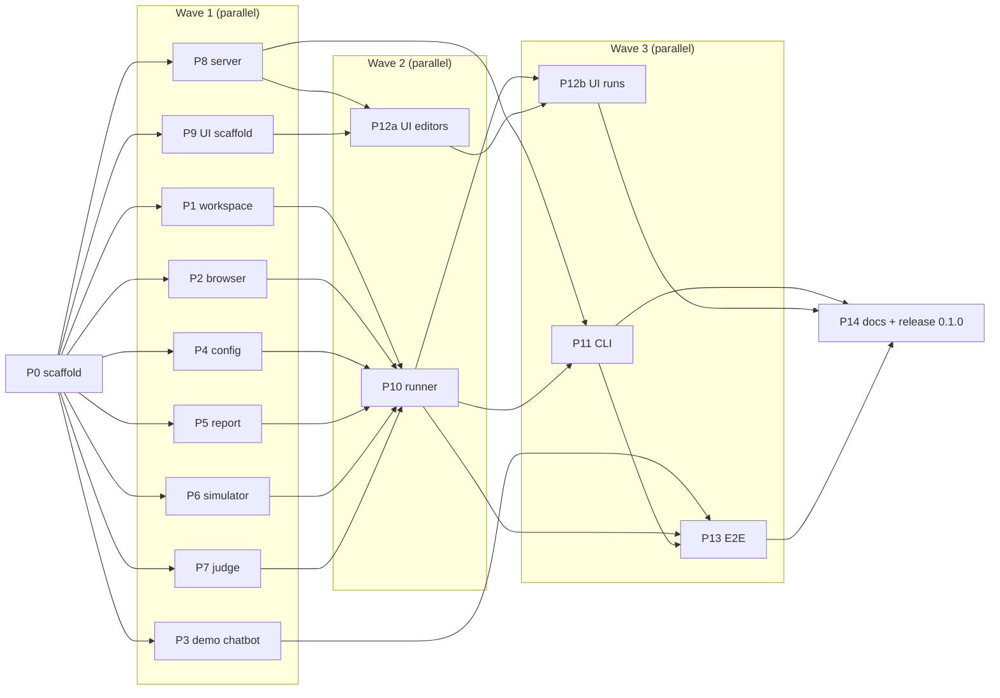

# agent-evaluator — implementation plan

Created 2026-10-19 (Phase 0 session). This directory is the hand-off artifact: every phase brief is
self-contained so a fresh agent/session can execute it without the original conversation.

## Goal

A local Node.js tool where a persona-driven LLM **simulator** drives a chatbot's web UI through
Playwright (accessibility-tree refs + screenshots), collects evidence (screenshots every step,
downloads, transcript, console), and a separate LLM **judge** scores the run against YAML rubrics,
producing an HTML report with a percentage score and PASS/FAILED. v0.1.0 = first end-to-end pipeline.

## Requirements captured from the owner (2026-10-19)

| Topic | Decision |
| --- | --- |
| Language / license | English docs, UI, examples. Apache-2.0, `Copyright 2026 numikel`, git author `numikel <81812273+numikel@users.noreply.github.com>` |
| Distribution | npm CLI (`npx agent-evaluator`) + repo. npm name `agent-evaluator` was free on 2026-10-19 (fallback `@numikel/agent-evaluator`) |
| Framework | `langchain@1.5` `createAgent` + `@langchain/langgraph`; **no** deepagents (peer conflict) |
| Perception | Hybrid: a11y refs default + screenshot every step; optional vision mode per target/scenario |
| Scoring | `max_turns` exhausted or `required` criterion failed ⇒ status FAILED, full criteria breakdown still reported. Score = Σ weight·score / Σ weight, `pass_threshold` per rubric |
| Target | `targets/*.yaml` (url, optional auth, natural-language hints, timeouts) + autodiscovery of the chat UI |
| Judge inputs | transcript + 2-stage screenshot selection (cap `max_images`, default 10) + downloaded files parsed to text + hybrid deterministic/LLM criteria. Multi-judge = v0.2 |
| Secrets | environment variables only, vault wrappers documented (dotenvx, `op run`, sops); UI shows presence only (ADR-0002) |
| Model selection | UI offers **only providers whose env key is set**; models are **listed live from each provider's API** (fallback list when unavailable); per role the user picks provider → model → `effort` (`none/low/medium/high/max`, mapped per provider since LangChain has no unified knob); context is never trimmed and output tokens default to the model's maximum |
| UI | Hono + React/Vite SPA; filesystem is the state; SQLite index deferred |
| First target | built-in demo chatbot fixture; real UIs later |
| Process | TDD red→green→refactor, one Conventional Commit per phase, phases run in parallel by subagents |

## Verified stack (npm registry + shipped `.d.ts`, 2026-10-19; installed in P0)

langchain 1.5.18 · @langchain/core 1.2.18 · @langchain/langgraph 1.5.1 · provider packages
(openai 1.6.2, anthropic 1.5.12, google-genai 2.3.2, openrouter 0.4.17, ollama 1.3.0, xai 1.4.17,
mistralai 1.2.0, groq 1.3.1) · playwright 1.64.1 · hono 4.13.13 + @hono/node-server 2.1.5 ·
zod 4.6.7 · yaml 2.9.1 · commander 15 · pino 10 · unpdf 1.9.1 · mammoth 1.13 · csv-parse 7 ·
vite 8.3.4 · react 19.3.1 · react-router 8.5 · vitest 5.0.5 · biome 2.5.15 · tsdown 0.23.1 ·
typescript 7.0.2 · msw 3 · @testing-library/react 16. Verified model ids: `claude-sonnet-5-5`,
`claude-opus-5-5`, `claude-haiku-5-5`, `claude-fable-5-1` (defaults use `anthropic:claude-sonnet-5-5`).

### API facts proven in P0 (see `src/testing/scripted-chat-model.test.ts`)

- `createAgent({ model, tools, systemPrompt, middleware, responseFormat })` from `"langchain"`; result has `messages` and `structuredResponse`.
- `responseFormat: zodSchema` binds a structured-output tool named `extract-N` (or the schema's title); with a non-native model the model must emit a tool call with that name. `ScriptedChatModel.boundToolNames()` exposes it.
- Image content block (v1): `{ type: "image", data: <base64>, mimeType: "image/png" }` inside `HumanMessage.content[]`. Never `image_url`, never inside `ToolMessage`.
- `initChatModel("provider:model")` provider ids: `openai, anthropic, azure_openai, google-genai, google-vertexai, ollama, mistralai, groq, bedrock, deepseek, xai, cerebras, fireworks, together, perplexity`. **`openrouter` is not in the map** → `new ChatOpenRouter({ model, apiKey })` from `@langchain/openrouter`.
- Playwright 1.64: `page.ariaSnapshot({ mode: "ai" })` → YAML with `[ref=eN]`; `page.getByRef("eN")`; `page.accessibility` removed (1.57). Verified from `.d.ts`; P2's first RED test guards it.
- zod 4: `.default({})` on nested objects does **not** apply inner defaults — use `.prefault({})` (done in schemas).
- TypeScript 7: no `baseUrl`; `paths` must be relative.
- tsdown: `fixedExtension: false` to emit `.js` (bin is `dist/cli.js`).

## Phases and dependency graph

| Phase | Brief | Commit | Subagent profile |
| --- | --- | --- | --- |
| P0 | `phase-00-scaffold.md` | `chore: scaffold project, contracts, test doubles and phase plans` | done (`c4ceeca`) |
| P1 | `phase-01-workspace.md` | `feat(workspace): …` | done (`0df3aef`) |
| P2 | `phase-02-browser.md` | `feat(browser): …` | done (`c970625`) |
| P3 | `phase-03-demo-chatbot.md` | `feat(fixtures): …` | done (`7b66a82`) |
| P4 | `phase-04-config.md` | `feat(config): …` | done (`f953b59`) |
| P5 | `phase-05-report.md` | `feat(report): …` | done (`140260a`) |
| P6 | `phase-06-simulator.md` | `feat(simulator): …` | done (`754d297`) |
| P7 | `phase-07-judge.md` | `feat(judge): …` | done (`a426469`) |
| P8 | `phase-08-server.md` | `feat(server): …` | done (`faed774`) |
| P9 | `phase-09-ui-scaffold.md` | `feat(ui): …` | done (`c501441`) |
| P10 | `phase-10-runner.md` | `feat(runner): …` | done (`23d3e5b`) |
| P11 | `phase-11-cli.md` | `feat(cli): …` | done (`a4357a9`) |
| P12a | `phase-12a-ui-editors.md` | `feat(ui): …` | done (`a0ac92b`) |
| P12b | `phase-12b-ui-runs.md` | `feat(ui): …` | done (`23126fa`) |
| P13 | `phase-13-e2e.md` | `test(e2e): …` | done (`3c60e93`) |
| P14 | `phase-14-release.md` | `docs: …` + `chore(release): 0.1.0` | done (this commit + the release commit) |

## Release notes from P14 (2026-10-19)

- The E2E suite was timing-sensitive: the scripted simulator sent its first message while the demo
  chatbot was still streaming its greeting, the demo dropped it (input busy) and the run FAILED.
  Fixed at the root in two places, each with a RED test first: `PlaywrightSession.type` now waits
  for a disabled/read-only field to become editable (Playwright's `press*` methods perform no
  actionability checks), and the demo disables its composer while a reply streams instead of
  silently discarding input. Recorded in ADR-0003 and CHANGELOG "Fixed".
- The CLI did not pass `workspaceRoot` to `EnvSecretsProvider`, so a plain `.env` was never loaded
  despite the README; it now loads `.env` from the working directory (hermetic in tests).
- `.env.example` listed `AE_WORKSPACE` / `AE_LOG_LEVEL`, which nothing reads; replaced by the real
  `AE_*` overrides, `AE_CHROMIUM_PATH` and `LOG_LEVEL`.
- Screenshots are generated by `docs/screenshots/capture.ts` (real server + UI + demo + scripted
  models, headless Chromium) and type-checked with the rest of the code.

## Wave 1 hand-off notes (2026-10-19, read before P10/P11/P12)

Verified on the integration branch after merging P1–P9: `npm run verify` green with 430 tests; real-Chromium smoke of P2+P3 (snapshot refs → type+submit → `waitForReplyStable` with interim shots → PDF download 1111 B); built UI renders at 360/1280 px without overflow; the PASSED report fixture renders in Chromium without errors. Chromium in this sandbox: Playwright's default build is absent, use `AE_CHROMIUM_PATH=/opt/pw-browsers/chromium` (P2 resolves it automatically).

- **Contract additions (all additive):** `BrowserSessionOptions.executablePath?` (P2); `ProviderDefinition.effortKnob` gained `"openrouter"`, `ProviderNotConfiguredError` exported from `src/config/types.ts` (P4).
- **P1 → runner:** `RunStore.root` is the runs directory itself (`join(workspace.root, settings.runs_dir)`); `loadSettings` returns defaults when the file is absent; names passed to loaders must be slugs; `saveDownload` stats the real size and suffixes duplicate names.
- **P2 → simulator/runner:** `waitForReplyStable` reports stable when the aria tree is unchanged for `stableMs` **and** no request younger than `stableMs` is in flight; a backend slower than `stableMs` to first token with no typing indicator may be reported stable before the reply lands — the simulator should verify the tree gained a bot message (`firstChangeMs === undefined` hints nothing happened). `factory.close()` must be called at shutdown. `PlaywrightSession.screenshotAnnotated()` exists for vision mode. Refs must come from the latest snapshot.
- **P3 → simulator:** demo UI a11y shape: `log "Conversation"` with `article` per message, `textbox "Message"` (`[active]` attribute may appear before `[ref=…]` — regexes must tolerate attributes), `button "Send"`, `button "Download"` inside the bot article, `button "Attach file"`, `status` live region "Assistant is typing…". `startDemo(port)` returns `{ url, port, app, close() }`.
- **P4 → runner/server/CLI:** `createProviderRegistry()`, `LangChainModelFactory` (injectable `initChatModel`), `resolveSettings({ file, env, cli })`, `runDoctor(...)`. OpenAI effort is passed as `reasoning: { effort }`; xAI effort is a no-op for `grok-*`; Anthropic rejects `temperature != 1` with extended thinking (not enforced).
- **P5 → runner:** `renderReport(input, options?)` returns exactly the `RunStore.saveReport` map; `resolved.rubric` must already have built-in criteria (P1 `resolve` does that); `inlineImages` uses an injected loader.
- **P6 → runner:** `runSimulator({ resolved, session, model, recorder, onMessage?, onDownload?, signal? })` does **not** call `session.open()` (runner does setup/login); `max_turns` enforced by middleware; `StepRecorder` interface in `src/agents/simulator/recorder.ts` — P10 implements a `RunStore`-backed one, moves downloads via `onDownload(result, stepId)`, derives `turn` events from user transcript entries, and maps reason `blocked` to a status (suggested: FAILED with `simulator_outcome.reason = "blocked"`).
- **P7 → runner:** `judgeRun(input, deps)`; judge-model errors propagate (map to ERROR); `extractDownloads` returns `text_excerpt` on `ExtractedFile`s only — persist into `downloads.json` so the report shows excerpts; `onCriterion` fires deterministic first.
- **P8 → runner/CLI/UI:** `createApp(deps: ServerDeps)` (`workspace, runStore, runner, providers, secrets, settingsLoader?, browserInstalled?, uiDir?, version?, heartbeatMs?`); pass `VERSION` from P11. The runner must `appendEvent` to `events.jsonl` **before** emitting so SSE late joiners get history; `POST /api/runs` returns 202; 404 mapping relies on `"not found"` in error messages (P1 errors comply). UI should read SSE as unnamed `data:` events with sequential ids.
- **P9 → P12:** route map and component API in `ui/src/app/routes.tsx`, `ui/src/api/client.ts` (`endpoints.*`), `ui/src/api/sse.ts`; msw handlers in `ui/src/mocks/`.

## Parallel-work rules (binding)

1. **No new dependencies** unless the brief lists them (P0 installed everything). If something is truly missing, add it and say so in the commit body.
2. **Ownership of shared files:** `src/index.ts` — P10 and P14 only (other phases export from their module's `index.ts`); `README.md` — P14 only; `package.json` scripts — only what a brief lists; `vitest.config.ts`, `biome.json`, `tsconfig*.json`, CI — P0/P14 only.
3. **Changelog:** write `changelog.d/phase-NN-<name>.md`; never edit `CHANGELOG.md`.
4. **Branching:** `phase/NN-name` from the integration branch; rebase onto it, then fast-forward merge in wave order. One squashed Conventional Commit per phase. Commit trailers (`Co-Authored-By`, session links) are added by the tooling and are fine; do not put model names into code or docs.
5. **Definition of done:** brief checklist ticked + `npm run verify` green (+ `npm run test:e2e` where the brief says so).
6. **Contracts are frozen:** `src/{browser,workspace,config,runner}/types.ts` and `src/schemas/*`. A change needs a note in `docs/decisions/` and a heads-up to dependent phases. Additive, backwards-compatible changes to schemas are allowed when a brief requires them.
7. **TDD inside each phase:** list the seams first, write one failing test per slice (RED), implement minimally (GREEN), refactor with tests green. Tests go through public seams, never private internals. Expected values come from the spec, not from the code under test.
8. **Doubles:** `ScriptedChatModel` for any LLM, `FakeBrowserSession` for the browser. Live-LLM tests only behind `AE_LIVE_LLM=1`.

## Reference skills (optional, for the executing agents)

The owner pointed at these; use what helps, none is mandatory:

- **TDD** (mattpocock/skills `skills/engineering/tdd`): red before green; one seam, one test, one minimal implementation per cycle; refactoring belongs to review; avoid tautological and implementation-coupled tests; prefer vertical "tracer bullet" slices. Adopted as rule 7.
- **code-review** (mattpocock/skills `skills/engineering/code-review`): review on two independent axes — standards (CLAUDE.md, Fowler smells) and spec (the phase brief). Use it before merging a phase.
- **agent-browser** (vercel-labs/agent-browser): CDP-based CLI with `@eN` refs, annotated screenshots whose numbered labels match refs, `--if-changed` screenshot dedupe, `state save/load`. Ideas adopted in P2 (annotated screenshots for vision mode, state persistence); not used as a dependency (no programmatic download events).
- **frontend-design** (anthropics/skills `skills/frontend-design`): plan a token system (4–6 colours, type roles), "spend your boldness in one place", avoid generic AI-UI clichés, responsive + focus states + reduced motion. Apply in P9/P12.
- **react-best-practices** (vercel-labs/agent-skills `skills/react-best-practices`): avoid waterfalls (`Promise.all`), no barrel imports, derive state during render, functional `setState`, `startTransition` for non-urgent updates. Apply in P9/P12.
- **web-design-guidelines** (vercel-labs/agent-skills): fetch `https://raw.githubusercontent.com/vercel-labs/web-interface-guidelines/main/command.md` and review UI code against it before finishing P12.
- **langchain-skills** (langchain-ai/langchain-skills): `langchain-fundamentals`, `langchain-middleware`, `langgraph-fundamentals` for API shapes; cross-check against the installed `.d.ts` when in doubt (the package moves fast).

## Roadmap after 0.1.0

Multi-judge voting · SQLite run index + trend dashboard · LangSmith tracing · OS keychain
`SecretsProvider` · scenario generator from an agent description · interaction-style perturbations
(typos, language switch) · Anthropic native computer-use toolset mode · `agent-browser` as an
alternative `BrowserSession` · real-UI targets with login flows.
